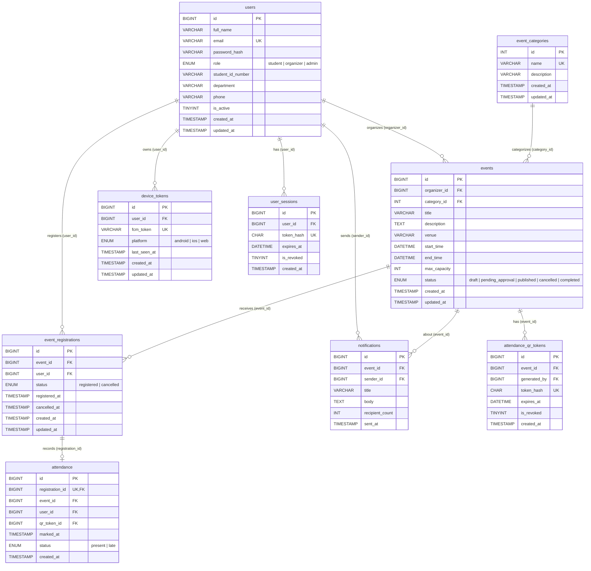

# Database Design
## Campus Event & Attendance Management System

## 1. Entity-Relationship (ER) Diagram

---

## 2. Table Explanations & Integrity Rules

1. **`users`**: Stores all students, organizers, and administrators. `email` is `UNIQUE`. Passwords are stored exclusively as `password_hash` (bcrypt).
2. **`event_categories`**: Normalized lookup table for event categories (Technical, Cultural, Sports, Workshop, Seminar).
3. **`events`**: Stores campus events linked to `organizer_id` (`users.id`) and `category_id` (`event_categories.id`). Indexed on `status`, `start_time`, and `category_id`.
4. **`event_registrations`**: Maps students to events. A composite unique constraint `UNIQUE KEY uq_event_user (event_id, user_id)` guarantees at the database level that a student cannot register twice for the same event.
5. **`attendance_qr_tokens`**: Stores SHA-256 hashes of time-limited QR tokens generated by organizers for a specific event.
6. **`attendance`**: References `registration_id` (`UNIQUE`), `event_id`, and `user_id`. The `UNIQUE KEY uq_attendance_registration (registration_id)` prevents duplicate attendance for the same registration.
7. **`device_tokens`**: Stores FCM registration tokens per user device (`fcm_token` is `UNIQUE` so re-registrations upsert cleanly).
8. **`notifications`**: Audit history of push notifications dispatched for events.
9. **`user_sessions`**: Stores SHA-256 hashes of server-issued opaque bearer tokens with `expires_at` and `is_revoked` for secure logout.
