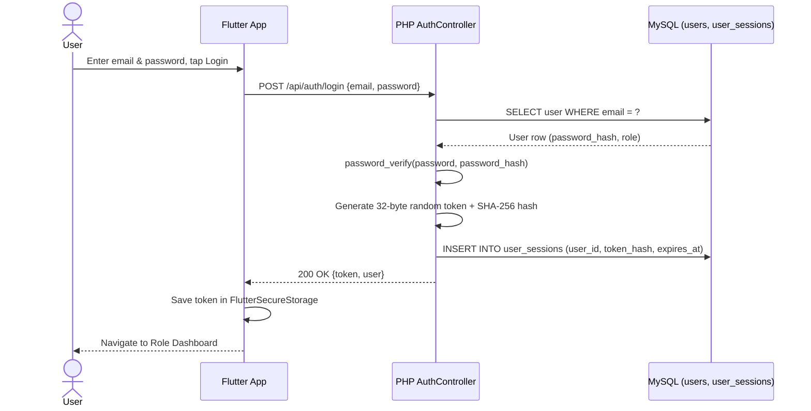
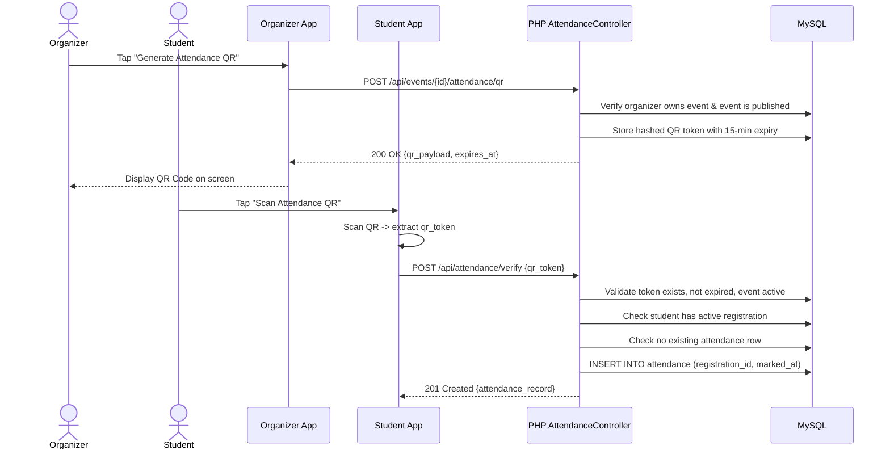
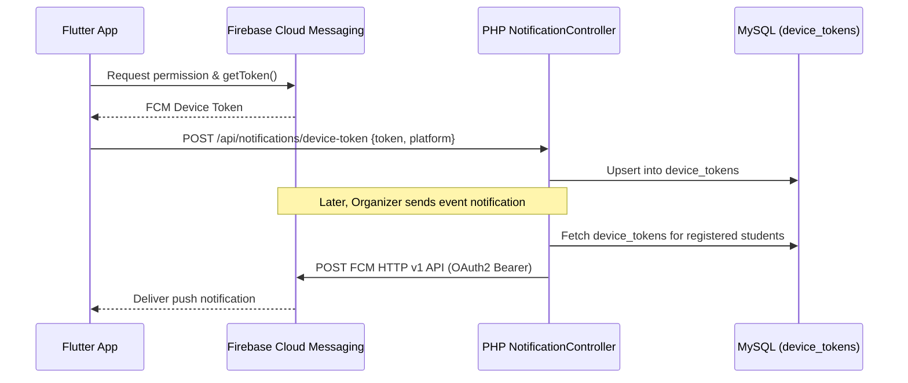

# System Design & Architecture
## Campus Event & Attendance Management System

## 1. High-Level Architecture

```mermaid
flowchart LR
    subgraph Mobile["Android Mobile App (Flutter)"]
        UI["Presentation Layer (Views & Widgets)"]
        VM["ViewModel Layer (ChangeNotifier / Provider)"]
        REPO["Repository Layer"]
        SVC["API & Storage Services (http, SecureStorage, FCM)"]
        UI --> VM --> REPO --> SVC
    end

    subgraph Backend["PHP 8 REST API (campus_event_api)"]
        RT["Router (routes/api.php)"]
        MW["Auth & Role Middleware"]
        CTRL["Controllers"]
        BSVC["Services (Auth, QR, FCM)"]
        BREPO["Repositories (PDO)"]
        RT --> MW --> CTRL --> BSVC --> BREPO
    end

    DB[("MySQL Database")]
    FCM["Firebase Cloud Messaging (FCM HTTP v1)"]

    SVC -- "HTTPS REST API (JSON + Bearer Token)" --> RT
    BREPO -- "PDO Prepared Statements" --> DB
    BSVC -- "OAuth2 Service Account + HTTP v1" --> FCM
    FCM -- "Push Notification" --> Mobile
```

### Key Architectural Decisions

1. **Why Flutter for the Frontend?**
   - Single codebase with fast Hot Reload, rich Material 3 widgets, strong typing with Dart, and mature packages for HTTP, secure storage, QR codes, and Firebase Messaging.
2. **Why PHP for the Backend?**
   - Ubiquitous, zero-friction setup (XAMPP / built-in PHP server), beginner-friendly procedural/OOP syntax, native `PDO` for MySQL, and simple deployment to shared hosting or VPS without heavy framework overhead.
3. **Why MySQL for Relational Data?**
   - Campus events, users, categories, registrations, and attendance are inherently relational. MySQL enforces referential integrity (`FOREIGN KEY`) and uniqueness (`UNIQUE KEY`) at the database engine level, preventing duplicate registrations and orphaned attendance records.
4. **Why REST API with JSON?**
   - Stateless, human-readable, platform-agnostic, and easy to inspect and test with Postman before writing a single line of Flutter networking code.
5. **Why Firebase ONLY for Push Notifications (in the default architecture)?**
   - MySQL + PHP already handle structured data, complex queries, and role-based authorization cleanly. Using Firebase solely for **Firebase Cloud Messaging (FCM)** avoids vendor lock-in and keeps all business rules in one authoritative PHP backend.
   - *Optional Alternatives*: Firebase Authentication or Cloud Firestore can replace PHP auth/MySQL in serverless architectures, but they are **not** dependencies here so beginners learn full-stack relational backend engineering.

---

## 2. Flutter Application Architecture (MVVM + Repository)

Each feature in `campus_event_app/lib/features/<feature>/` is organized into clear layers:

1. **Models (`models/`)**: Immutable Dart classes with `fromJson()` and `toJson()` factories.
2. **Services (`services/`)**: Thin classes calling `ApiClient` (`http`) or device plugins (`FlutterSecureStorage`, `FirebaseMessaging`). No UI state.
3. **Repositories (`repositories/`)**: Coordinate data fetching/caching and transform raw responses or exceptions into domain models.
4. **ViewModels (`viewmodels/`)**: Extend `ChangeNotifier` (via `provider`). Hold UI state (`isLoading`, `errorMessage`, data lists) and expose user actions (`loadEvents()`, `register()`). Never perform raw HTTP calls.
5. **Views (`views/`)**: Stateless/Stateful `Widget` screens that observe ViewModels via `context.watch<T>()` / `Consumer<T>()` and trigger actions via `context.read<T>()`.

---

## 3. Core Sequence Flows

### 3.1 Authentication Flow (Opaque Bearer Token)

### 3.2 QR Attendance Flow (Time-Limited Token)

### 3.3 Push Notification Flow

